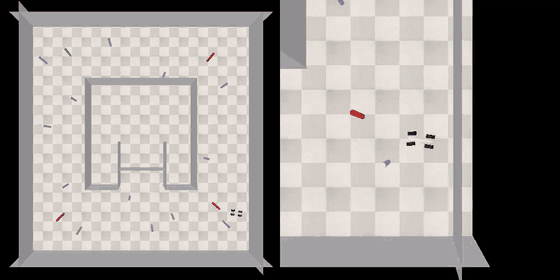
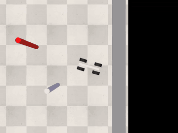
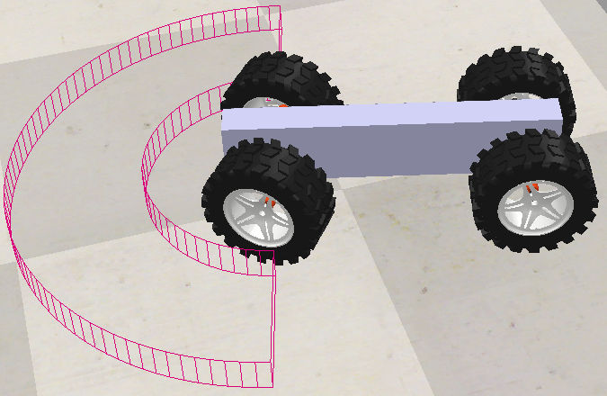

# A simulated car you can drive, or that drives and parks itself

Simulation of Systems (SmSs), work 2, 2025/2026 · Python · CoppeliaSim, pygame.

## What

A small ground vehicle in CoppeliaSim that follows a predefined path, avoids obstacles, performs a
parallel-parking manoeuvre, and can also be driven by hand with a Logitech MOMO steering wheel and
pedals.

## How

A Python client talks to CoppeliaSim through the ZeroMQ remote API, stepping the simulation itself.
In automatic mode a PID controller sets the steering angle from the heading error to the next
reference point; when the front proximity sensor sees an obstacle, the car steers at full lock to the
side away from it. Parking mode switches to a sequence of parking references once the car passes the bay. In manual mode the
steering wheel and pedals (read with pygame) set the steering angle and speed directly. A small
text interface in the terminal shows the mode, steering angle and speed.

## Results

<table>
  <tr>
    <td width="60%"></td>
    <td width="40%"></td>
  </tr>
  <tr>
    <td>A lap in automatic mode: whole course (left) and a camera following the car (right). The
      green post is the current reference. (<a href="media/lap.mp4">MP4</a>)</td>
    <td>Parking mode: forward to the first mark, then reverse into the bay.
      (<a href="media/parking.mp4">MP4</a>)</td>
  </tr>
</table>

The clips were recorded headless in CoppeliaSim 4.10 with this client unchanged, the keys pressed
by a script, and frames taken from two vision sensors added for the recording; they play about
10× (lap) and 5× (parking) faster than the simulation.

<table>
  <tr>
    <td width="50%"></td>
    <td width="50%"></td>
  </tr>
  <tr>
    <td>The obstacle course built in CoppeliaSim.</td>
    <td>The car after the automatic parallel-parking routine.</td>
  </tr>
  <tr>
    <td></td>
    <td></td>
  </tr>
  <tr>
    <td>The vehicle model.</td>
    <td>The text interface.</td>
  </tr>
</table>

The full write-up is in [`report/report.pdf`](report/report.pdf).

## Contents

| Path | Content |
|---|---|
| `scene.ttt` | CoppeliaSim scene: car, obstacle course, reference points and parking bay |
| `vehicle_client.py` | The controller: manual, automatic and parking modes, PID steering, obstacle avoidance, text interface |
| `joystick_test.py` | Small pygame check that the steering wheel is detected |
| `report/` | Report (`report.pdf`) and its LaTeX source |
| `media/` | Figures above |

## Running

1. Open `scene.ttt` in CoppeliaSim (tested with 4.10) and leave the simulation stopped; the client
   starts and steps it.
2. `pip install coppeliasim-zmqremoteapi-client pygame`
3. `python vehicle_client.py`

Keys (with the small pygame window focused): `M` manual, `N` automatic, `P` parking, `Q` quit. In
manual mode without a steering wheel, `A`/`D` steer and `U`/`I` raise and lower the speed.

## License

GPL-3.0, see [LICENSE](LICENSE).
